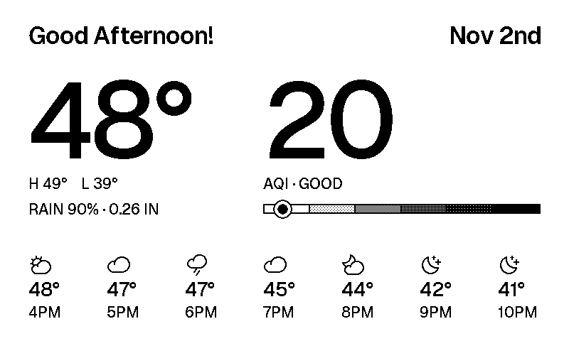

# Weather and AQI Display

A little e-ink screen fridge magnet. Once an hour it shows the weather and the local air quality (the average of PurpleAir sensors within 5 miles), then goes back to sleep. 

## Hardware

| Part | What it does |
|---|---|
| [XIAO ESP32-C3](https://www.seeedstudio.com/Seeed-XIAO-ESP32C3-p-5431.html) | The brain: Wi-Fi plus a tiny chip that sleeps most of the time |
| [ePaper Driver Board for XIAO (V2)](https://wiki.seeedstudio.com/xiao_eink_expansion_board_v2/) | The XIAO and screen plug into it; also charges the battery |
| 4.26" mono e-ink, 800×480 | The screen. It keeps the picture with zero power. |
| 3.7V LiPo, JST-PH 2.0 | The battery |

## How it works

A Cloudflare Worker (`cloud/`) does the work: it pulls PurpleAir and Open-Meteo data and sends back ready-to-draw JSON. The XIAO (`firmware/`) wakes up, grabs it, draws it in Geist with Phosphor icons, and goes back to sleep until the next hour.
